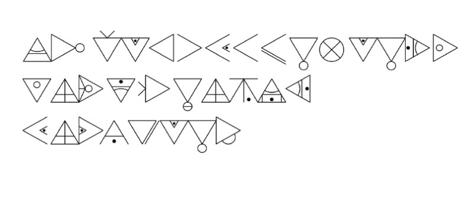

import ScriptDetails from '../../../../components/ScriptDetails.astro';
import WsList from '../../../../components/WsList.astro';
import ArticlesList from '../../../../components/ArticlesList.astro';
import SourceLinksList from '../../../../components/SourceLinksList.astro';
import BibList from '../../../../components/BibList.astro';
import Attribution from '/src/components/Attribution.astro';
import CaptionText from '/src/components/CaptionText.astro';

<CaptionText text="Inscription in Ditema tsa Dinoko: Tshimo ya ka eo ke e lemang ka matsoho, ha dijo tsa yona di butswitse, ke di kotula ka mahlo."/>
<Attribution
    type="Image"
    copyyears="2026"
    license="CC0 1.0"
    author="Gwaza"
    source="Wikimedia"
    sourceurl="https://commons.wikimedia.org/wiki/File:Tshimo_ya_ka_(extract_from_Interowriting-Interoreading_Zine_by_Alice_S%CE%A3S%F0%90%A4%87%E1%BA%A0%CC%8AT_%F0%93%8B%88_and_Pule_L%CE%A3P%E2%96%BD-1).jpg"
/>

## Script details

<ScriptDetails />

## Script description

The Ditema tsa Dinoko script was designed for Southern Bantu languages. It would also work with ǀXam and Nǀuu as well as many other languages which do not yet have a standardized orthography such as ChiChopi, ChiKaranga, ChiKorekore, ChiManyika, ChiNambya, ChiNdau, ChiZezuru, GiTonga, IsiBhaca, IsiHlubi, IsiMpondo, IsiNdebele , IsiXesibe, IsiXhosa, IsiZulu, KheLobedu, SePedi, SePulana, SeSotho, SeTswana, SheKgalagari, SiCele, SiHlangwini, SiLaNgomane, SiLozi, SiNrebele, SiPhuthi, SiSwati, SiThonga, TjiKalanga, TshiVenḓa, XiRhonga, XiSsonga, XiTsonga and XiTswa.

_This script is not currently recognized by the [ISO 15924 standard](http://www.unicode.org/iso15924/), but is included in Writing Systems Technical Resources for research purposes. If you have any information on this script, please add the information to this site. Your contributions can be a great help in refining and expanding the ISO 15924 standard. The [Script Encoding Initiative](https://sei.berkeley.edu/) is working to support the inclusion of this script in the standard, and contributions here will support their efforts._

## Languages that use this script

<WsList script='x-ditema-tsa-dinoko' wsMax='5' />

## Unicode status

The Ditema tsa Dinoko script is not yet in Unicode. It is not yet in the Roadmap for the Unicode Standard. 

- [Full Unicode status for Ditema tsa Dinoko](/scrlang/unicode/x-ditema-tsa-dinoko-unicode)

## Resources

<ArticlesList tag='script-x-ditema-tsa-dinoko' header='Related articles' />

<SourceLinksList tag='script-x-ditema-tsa-dinoko' header='External links' entrytype='online' />

<BibList tag='script-x-ditema-tsa-dinoko' header='Bibliography' entrytype='non-online' />

